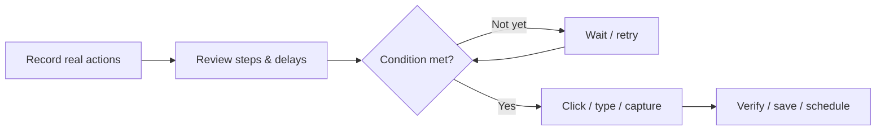

<div align="center">


# TASK RUNNER

### RECORD · REPLAY · OBSERVE · CAPTURE · DEBUG · RECOVER · MONITOR

**Visual desktop automation and workflow scheduling for Windows.**

[](V1.5.1_RELEASE_NOTES.md)
[](#windows-quick-start)
[](requirements.txt)

[](#the-visual-identity)
[](#what-you-can-do)
[](SECURITY.md)
[](#quality-gates)

**Background Gremlin Group**  
*Creating Unique Tools for Unique Individuals*

[Explore features](#what-you-can-do) · [Build on Windows](#windows-quick-start) · [Action guide](docs/USER_GUIDE.md) · [v1.5.1 release notes](V1.5.1_RELEASE_NOTES.md) · [Previous releases](old%20builds/README.md)

</div>

---

> [!IMPORTANT]
> **Version 1.5.1 — Windows source release.** Build from source on Windows 10/11. New desktop-recording, debugging, OCR, and installer paths require hands-on Windows verification before a prebuilt executable is offered.



Task Runner is a native Windows application for composing, scheduling, monitoring, and troubleshooting multi-step desktop and browser automations. Its screenshot-driven wizard lets you select real desktop coordinates; its action editor provides Playwright-based browser operations, Beautiful Soup extraction, Windows UI Automation, clipboard and file handling, conditional flows, verification, retries, and deliberate timing controls.

The interface takes inspiration from vaporwave aesthetics and classic Windows desktop software. Seven original short retro interface sounds—selection, execution, saving, completion, failure, startup, and exit—can be switched off in Settings without affecting workflows.

**Current release:** v1.5.1 source with a local Windows build system. Native Windows verification of the new features is pending; a signed or acceptance-tested executable is not yet advertised.

## New in Task Runner 1.5.1

**More reliable OOM monitoring:** Resource guards now recognize PID reuse across all policies, so a newly started application cannot silently inherit another process's watch. Explicit guard shutdowns cannot lose a late cancellation or initiate new termination after a slow metric read completes. Warning-only remains the default; user files are never deleted by this feature.

**Safer Windows upgrades:** If application registration fails during installation, the installer attempts to restore the previous installed build before reporting the error. The same original application UI, tasks, scheduler, installer/uninstaller, sounds and prior source archives remain available.

[Read the v1.5.1 release notes](V1.5.1_RELEASE_NOTES.md) · [Complete changelog](CHANGELOG.md)

## New in Task Runner 1.5

**Resource Monitor / OOM safeguards:** A new read-only Resource Monitor shows available system RAM and memory used by a selected program plus its child processes. A separate GPU check can report NVIDIA total VRAM and compute-process VRAM where the local driver supports it.

Add **Record RAM / VRAM snapshot**, **Start RAM / VRAM guard**, or **Stop RAM / VRAM guard** to an existing workflow. Set process memory ceilings, minimum available system RAM, and optional NVIDIA VRAM ceilings. Warning-only is the default; you can explicitly opt into workflow cancellation or stopping only an executable launched by the same workflow. No cleanup deletes user files or terminates unrelated processes automatically.

[v1.5.0 features and limitations](V1.5_RELEASE_NOTES.md) · [Previous v1.4.0 source](old%20builds/v1.4.0/) · [Public changelog](CHANGELOG.md)

## New in Task Runner 1.4

Task Runner now has an **interactive playback debugger**. Start **▶ Debug replay** from the Dashboard, inspect the live action timeline in Execution Logs, pause or single-step, and retry a failed step only when you authorize it. Use **Teach current click…** to take a fresh desktop screenshot and correct the saved target. **Ctrl+Shift+F11** is the emergency stop hotkey during an active run (the recorder still stops with Ctrl+Shift+F12).

**Precision:** Click steps can resolve UI Automation control IDs/names, reference images, and recorded window-relative positions, with strict matching to reject ambiguous targets. Legacy coordinate-only tasks remain compatible.

**Watch and capture:** Offline OCR supports stable text-on-screen triggers; file/folder event schedules react to changes, and the Output Gallery previews local images/text and exports checksummed private bundles.

**Recover and reuse:** Resume from a verified checkpoint after explicit review when the task is linear and no volatile state is missing. Reuse existing tasks as modules, store named secrets using Windows DPAPI, and exchange portable `.trpkg` bundles containing references and disabled-by-default workflows.

[Full v1.4 notes and limitations](V1.4_RELEASE_NOTES.md) · [Previous v1.3.0 source](old%20builds/v1.3.0/) · [Public changelog](CHANGELOG.md)

## What you can do

| Feature | Implementation |
| --- | --- |
| Visual desktop targeting | Full-virtual-desktop screenshot, coordinate picker, click/move/drag/scroll, and selection-based typing |
| Capture transient menus | Arm capture and wait 0–30 seconds before freezing the desktop, including right-click menus |
| **Record & replay** | Record mouse clicks, typing, scrolls, keyboard shortcuts and real waits; stop with Ctrl+Shift+F12 and save as editable workflow steps |
| **Event-based triggers** | Wait for screen/image appearance or change; detect new text/code/output in windows, browser pages, files and clipboard |
| **Live output and rendered images** | Record changed desktop regions, clipboard images, new image files, window text and file output as versioned snapshots with a manifest |
| **Resource Monitor / OOM guards** | Read-only RAM/process inspection, NVIDIA compute VRAM checks, workflow thresholds with warnings, optional cancellation and verified owned-process termination |
| **More accurate targeting** | Use window-relative/accessible controls from recordings, or click the current position of a matching reference image |
| **Windows installation & uninstall** | Per-user installed app with Start Menu/Installed Apps entry; uninstall without removing shared dependencies |
| Reliable action sequencing | Before- and after-action waits, retry delays, optional screen-change/window/file/browser verification |
| Browser automation | Playwright Chromium navigation, clicking, typing, dropdown choices, screenshots, downloads, state waits |
| Expand and inspect controls | HTML `<details>` and ARIA disclosures, `<select>` options, Windows UI Automation dropdown inspection |
| Capture long content | Scroll browser pages and overflow containers; collect Windows app text through UI Automation and clipboard fallback |
| Parse pages | Download HTML by HTTP, extract rendered HTML, parse CSS selectors and attributes with Beautiful Soup |
| Control flow | Nested If / Else branches, bounded Repeat loops, Break / Continue, workflow variables and interpolation |
| Files and clipboard | Create/read/write/append/copy/move/delete/list, clipboard reading and writing, launch and wait for windows |
| Schedule and monitor | Manual, one-time, interval, daily, weekly, and five-field cron schedules with SQLite execution history |
| Preserve and inspect | JSON job import/export, execution-log export, failure screenshots, live SQLite database backup |
| Build locally | Windows `.cmd` launcher, shared user-level Python dependencies, PyInstaller, packaged browser and self-test |

No screen coordinates are required for the Playwright browser actions or CSS-based extraction steps. Browser actions operate on the browser instance that Task Runner opens, not on arbitrary already-open Chrome tabs. Windows controls are limited by the target application's accessibility implementation. Screen-change verification confirms that pixels changed; it does not prove the intended business operation succeeded.

## Windows quick start

**Requirements:** Windows 10/11 x64, a normal x64 Python 3.11–3.13 installation, an active user session for native desktop automation, and internet access for the first dependency/Chromium installation.

1. Download or clone the repository into a writable directory.
2. Double-click **`BUILD_WINDOWS.cmd`** from the project root. It chooses an installed shared Python interpreter, checks and installs missing packages into user-level site-packages (not a `.venv`), runs the tests, installs/reuses Playwright Chromium, builds the Windows application, and performs a packaged-runtime self-test.
3. Launch **`dist\TaskRunner\TaskRunner.exe`**. Preserve the entire `dist\TaskRunner` folder, including `_internal` and `browser-binaries`. For a registered Windows installation, run **`INSTALL_WINDOWS.cmd`** after compiling.
4. Choose **New Task**. Give the task a name; use **● Record actions / Replay** to perform the real workflow, press **Ctrl+Shift+F12** to stop, then edit its captured actions, delays and verification. You can also build individual actions through screenshot selection.
5. Use **Run now** while testing. Check **Logs** and inspect failure screenshots. Review any shutdown, file deletion, program launch, or overwrite action before scheduling.
6. To run scheduled tasks when the GUI is closed, install the Windows heartbeat from Settings or `INSTALL_SCHEDULER.cmd`. It runs under the signed-in interactive Windows account. Use **Windows Installed Apps → Task Runner → Uninstall** or **`UNINSTALL_WINDOWS.cmd`** to uninstall; local data is preserved by default.

**Important timing distinction:** The GUI polls schedules approximately once per second while open. The current Windows Task Scheduler heartbeat runs once per minute when the GUI is closed. Thus a saved **one-second interval is not guaranteed to execute every second with the GUI closed**. A scheduled desktop workflow also requires the user to be logged in and the desktop unlocked. This limitation is explicitly retained rather than misrepresented as background second-precision execution.

You can run directly from source with **`RUN_FROM_SOURCE.cmd`**, or precheck reusable dependencies via **`CHECK_DEPENDENCIES.cmd`**. No global administrator-level installation is required for the intended shared user-site setup. The first install can be blocked by local Python/Windows policy. The dependency installer retries a pip wheel-cache permission problem without cache before failing visibly.

## Record and replay a workflow

Start a new task and click **● Record actions / Replay**. After the wizard hides, operate your programs just as you normally would. Use **Ctrl+Shift+F12** to stop. The generated steps include real elapsed waits and window-appearance checkpoints when the program changes. Review them and choose **Save + Run now** to test the replay.

To react to asynchronous events, insert **Wait for visual change**, **Wait for text / code / output**, or **Click on-screen image**. To collect changing output while actions continue, put **Start live output / image capture** before the relevant work and **Stop live output capture** afterward. You can also save images copied to the clipboard. Captures go to the output folder you configure.

**Privacy notice:** Recording can capture typed credentials; do not type secrets during recording. Captured steps and output files may contain private information and are stored locally.

## A real automation example

Create a workflow that (1) opens a folder or program, (2) waits for its window, (3) activates it, (4) clicks or types into an exact target, (5) checks for a response, (6) captures scrolling text, (7) saves a UTF-8 report, and (8) closes an application. Configure one-second settling delays after context-sensitive actions and verification on the states that must actually change. A failed verification can cause a retry; merely dispatching a click is not proof that the click achieved its purpose.

For your first automation, prefer **Run now** on noncritical files, then move it to a timed schedule. Imported JSON jobs are disabled until reviewed, but they can perform real operating-system actions once run.

## Persistence and safer recovery

Task Runner saves jobs and execution history to a local SQLite database in `%LOCALAPPDATA%\TaskRunner` by default. Settings provides **Backup task database…**, which uses SQLite's online backup API and an integrity check, producing a consistent snapshot even if the database is in use. The backup contains jobs and execution history, **not** settings or screenshot files. Keep it private: stored steps and logs can contain user-sensitive data.

File replacement now stages a complete UTF-8 write or copied file beside the destination before atomically replacing the old file. If staging fails, the previous destination stays in place. Append and move-file/directory actions retain their existing semantics; review destructive steps carefully. Task Runner does **not** claim to sandbox arbitrary workflows or encrypt its SQLite database.

## The visual identity

The application preserves its current Windows/Qt layout, original vaporwave icon, background styling, and optional retro sound cues. This repository does not substitute a concept render for screenshots captured from a running Windows build. Actual UI screenshots can be added after on-device acceptance.

## Directory guide

```text
taskrunner/
  task_runner/                 Application GUI, scheduler, workflow engine, storage, Windows input
  assets/                      Original icon, Windows executable resource and seven WAV cues
  tests/                       Regression tests and source-validation checks
  scripts/                     Build utilities and workflow schema generator
  schemas/taskrunner-job.schema.json
  docs/                        Full user guide and system architecture
  .github/                     Public issue forms and repository configuration
  BUILD_WINDOWS.cmd            Windows standalone-directory EXE build
  CHECK_DEPENDENCIES.cmd       Install/check reusable Python dependencies
  RUN_FROM_SOURCE.cmd          Launch the Windows GUI from source
  INSTALL_SCHEDULER.cmd        Register interactive Windows scheduler heartbeat
  INSTALL_WINDOWS.cmd          Install compiled app per-user; adds Start Menu and Installed Apps
  UNINSTALL_WINDOWS.cmd        Uninstall app; optional explicit local data deletion
  REMOVE_SCHEDULER.cmd         Remove scheduler heartbeat
  SECURITY.md                  Security and vulnerability reporting
  CONTRIBUTING.md              Contribution / regression requirements
  LICENSING.md                 Copyright and license status
```

## Quality gates

Run these checks locally before building:

```powershell
python -m pytest tests -q
python -m compileall -q task_runner scripts tests launcher.py
python scripts/prepublish_audit.py
```

The source checks validate workflows and code paths; desktop targeting, the debugger, installer, and other Windows-specific behavior should also be checked on the intended machine.

Workflow export JSON structure is documented in [`schemas/taskrunner-job.schema.json`](schemas/taskrunner-job.schema.json). If action fields change, run `python scripts/generate_workflow_schema.py` and include the synchronized schema and tests.

The Windows build script runs checks before packaging the application.

## Previous releases and changelog

Browse preserved source snapshots for [**v1.3.0**](old%20builds/v1.3.0/) and [**v1.2.1**](old%20builds/v1.2.1/), or read the [**Changelog**](CHANGELOG.md) for version-by-version features and fixes. Archived builds contain source and build scripts, not verified executables.

## Documentation

- [Full action and workflow guide](docs/USER_GUIDE.md) — existing and new workflow actions.
- [v1.3 release notes](V1.3_RELEASE_NOTES.md) — recording, visual triggers, output capture, installation and removal.
- [Security policy](SECURITY.md) — local trust boundaries and private vulnerability reporting.
- [Contributing](CONTRIBUTING.md) — no-regression and change verification expectations.
- [Licensing](LICENSING.md) — copyright and reuse terms.


---

<div align="center">

**BACKGROUND GREMLIN GROUP**

*Creating Unique Tools for Unique Individuals*

</div>
