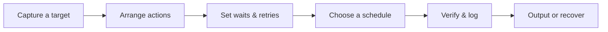

<div align="center">


# TASK RUNNER

### ⚡ CAPTURE THE DESKTOP. BUILD THE WORKFLOW. RUN ON YOUR SCHEDULE.

**Visual automation for Windows — without having to hand-code every step.**

`WINDOWS 10 / 11` · `PYSIDE6` · `PLAYWRIGHT` · `BEAUTIFUL SOUP` · `LOCAL-FIRST`

**Background Gremlin Group**  
*Creating Unique Tools for Unique Individuals*

[**Quick start**](#windows-quick-start) · [**Capabilities**](#capabilities) · [**Action guide**](docs/USER_GUIDE.md) · [**Security**](SECURITY.md)

</div>

---

> [!IMPORTANT]
> **Release status:** v1.2.1 Windows source and local EXE builder. The UI and an earlier build have run on Windows; the current hardening changes still need a fresh interactive Windows acceptance pass before a verified binary release is advertised. No paid GitHub Actions are used.

Task Runner is a native Windows application for composing, scheduling, monitoring, and troubleshooting multi-step desktop and browser automations. Its screenshot-driven wizard lets you select real desktop coordinates; its action editor provides Playwright-based browser operations, Beautiful Soup extraction, Windows UI Automation, clipboard and file handling, conditional flows, verification, retries, and deliberate timing controls.

The interface takes inspiration from vaporwave aesthetics and classic Windows desktop software. Seven original short retro interface sounds—selection, execution, saving, completion, failure, startup, and exit—can be switched off in Settings without affecting workflows.

**Built for an actual Windows desktop.** All builds run locally. No hosted build pipeline, usage-credit-consuming GitHub Actions, or unverified downloadable EXE is represented as a completed release.

### From a screen capture to an autonomous sequence



| **DESKTOP** | **BROWSER** | **CONTROL** |
|:---|:---|:---|
| Point-and-click, typing, windows, clipboard, files | Playwright, dropdowns, scrolling text, HTML extraction | Conditional flows, retries, delays, scheduling, logs |

**Built for elaborate tasks:** open a folder, launch a program, wait for its window, fill a form, copy long output, save a report, and optionally shut down the machine—all as one ordered, editable workflow.

---

## Capabilities

| Feature | Implementation |
| --- | --- |
| Visual desktop targeting | Full-virtual-desktop screenshot, coordinate picker, click/move/drag/scroll, and selection-based typing |
| Capture transient menus | Arm capture and wait 0–30 seconds before freezing the desktop, including right-click menus |
| Reliable action sequencing | Before- and after-action waits, retry delays, optional screen-change/window/file/browser verification |
| Browser automation | Playwright Chromium navigation, clicking, typing, dropdown choices, screenshots, downloads, state waits |
| Expand and inspect controls | HTML `<details>` and ARIA disclosures, `<select>` options, Windows UI Automation dropdown inspection |
| Capture long content | Scroll browser pages and overflow containers; collect Windows app text through UI Automation and clipboard fallback |
| Parse pages | Download HTML by HTTP, extract rendered HTML, parse CSS selectors and attributes with Beautiful Soup |
| Control flow | Nested If / Else branches, bounded Repeat loops, Break / Continue, workflow variables and interpolation |
| Files and clipboard | Create/read/write/append/copy/move/delete/list, clipboard reading and writing, launch and wait for windows |
| Schedule and monitor | Manual, one-time, interval, daily, weekly, and five-field cron schedules with SQLite execution history |
| Preserve and inspect | JSON job import/export, execution-log export, failure screenshots, live SQLite database backup |
| Build locally | Windows `.cmd` launcher, shared user-level Python dependencies, PyInstaller, packaged browser and self-test |

No screen coordinates are required for the Playwright browser actions or CSS-based extraction steps. Browser actions operate on the browser instance that Task Runner opens, not on arbitrary already-open Chrome tabs. Windows controls are limited by the target application's accessibility implementation. Screen-change verification confirms that pixels changed; it does not prove the intended business operation succeeded.

## Windows quick start

**Requirements:** Windows 10/11 x64, a normal x64 Python 3.11–3.13 installation, an active user session for native desktop automation, and internet access for the first dependency/Chromium installation.

1. Download or clone the repository into a writable directory.
2. Double-click **`BUILD_WINDOWS.cmd`** from the project root. It chooses an installed shared Python interpreter, checks and installs missing packages into user-level site-packages (not a `.venv`), runs the tests, installs/reuses Playwright Chromium, builds the Windows application, and performs a packaged-runtime self-test.
3. Launch **`dist\TaskRunner\TaskRunner.exe`**. Preserve the entire `dist\TaskRunner` folder, including `_internal` and `browser-binaries`.
4. Choose **New Task**. Give the task a name; capture targets or use the action catalog, configure waits/retries/verification, choose a schedule, validate, and save.
5. Use **Run now** while testing. Check **Logs** and inspect failure screenshots. Review any shutdown, file deletion, program launch, or overwrite action before scheduling.
6. To run scheduled tasks when the GUI is closed, install the Windows heartbeat from Settings or `INSTALL_SCHEDULER.cmd`. It runs under the signed-in interactive Windows account.

**Important timing distinction:** The GUI polls schedules approximately once per second while open. The current Windows Task Scheduler heartbeat runs once per minute when the GUI is closed. Thus a saved **one-second interval is not guaranteed to execute every second with the GUI closed**. A scheduled desktop workflow also requires the user to be logged in and the desktop unlocked. This limitation is explicitly retained rather than misrepresented as background second-precision execution.

You can run directly from source with **`RUN_FROM_SOURCE.cmd`**, or precheck reusable dependencies via **`CHECK_DEPENDENCIES.cmd`**. No global administrator-level installation is required for the intended shared user-site setup. The first install can be blocked by local Python/Windows policy. The dependency installer retries a pip wheel-cache permission problem without cache before failing visibly.

## What a workflow looks like

Create a workflow that (1) opens a folder or program, (2) waits for its window, (3) activates it, (4) clicks or types into an exact target, (5) checks for a response, (6) captures scrolling text, (7) saves a UTF-8 report, and (8) closes an application. Configure one-second settling delays after context-sensitive actions and verification on the states that must actually change. A failed verification can cause a retry; merely dispatching a click is not proof that the click achieved its purpose.

For your first automation, prefer **Run now** on noncritical files, then move it to a timed schedule. Imported JSON jobs are disabled until reviewed, but they can perform real operating-system actions once run.

## Persistence and safer recovery

Task Runner saves jobs and execution history to a local SQLite database in `%LOCALAPPDATA%\TaskRunner` by default. Settings provides **Backup task database…**, which uses SQLite's online backup API and an integrity check, producing a consistent snapshot even if the database is in use. The backup contains jobs and execution history, **not** settings or screenshot files. Keep it private: stored steps and logs can contain user-sensitive data.

File replacement now stages a complete UTF-8 write or copied file beside the destination before atomically replacing the old file. If staging fails, the previous destination stays in place. Append and move-file/directory actions retain their existing semantics; review destructive steps carefully. Task Runner does **not** claim to sandbox arbitrary workflows or encrypt its SQLite database.

## Vaporwave desktop experience

The existing Windows/Qt interface stays intact. The custom icon, vaporwave color system, and **seven original optional sound cues** (select, run, save, done, error, startup, exit) are included in `assets/`. Toggle interface audio in Settings without altering workflow execution. Only genuine application screenshots should be presented as product captures; no mockup is labeled as a real Windows screenshot.

## Source layout

```text
taskrunner/
  task_runner/                 Application GUI, scheduler, workflow engine, storage, Windows input
  assets/                      Original icon, Windows executable resource and seven WAV cues
  tests/                       Regression and source validation tests
  scripts/                     Shared dependency checker, schema generator and publication audit
  schemas/taskrunner-job.schema.json
  docs/                        Full user guide and architecture
  .github/                     Issue forms and example main protection configuration
  BUILD_WINDOWS.cmd            Windows standalone-directory EXE build
  CHECK_DEPENDENCIES.cmd       Install/check reusable Python dependencies
  RUN_FROM_SOURCE.cmd          Launch the Windows GUI from source
  INSTALL_SCHEDULER.cmd        Register interactive Windows scheduler heartbeat
  REMOVE_SCHEDULER.cmd         Remove scheduler heartbeat
  SECURITY.md                  Security and vulnerability reporting
  CONTRIBUTING.md              Contribution / regression requirements
  LICENSING.md                 Copyright and license status
```

## Test it locally

Run locally, with no GitHub Actions or paid hosted runners:

```powershell
python -m pytest tests -q
python -m compileall -q task_runner scripts tests launcher.py
python scripts/prepublish_audit.py
```

The pre-publication audit detects obvious private-data filenames, private-key/token signatures, unexpectedly large files, and GitHub Actions workflows. It is not a substitute for manually reviewing the staged diff, enabling GitHub secret scanning, or testing Windows-only functionality.

Workflow export JSON structure is documented in [`schemas/taskrunner-job.schema.json`](schemas/taskrunner-job.schema.json). If action fields change, run `python scripts/generate_workflow_schema.py` and include the synchronized schema and tests.

**No GitHub Actions workflows are included.** Builds and acceptance tests are local. Dependency changes and Windows releases require explicit local review.

## Documentation and public-release policy

- [Full action and workflow guide](docs/USER_GUIDE.md) — complete existing feature documentation, preserved from the prior package.
- [Security policy](SECURITY.md) — local trust boundaries and private vulnerability reporting.
- [Contributing](CONTRIBUTING.md) — no-regression and change verification expectations.
- [Licensing status](LICENSING.md) — no license has been selected by the owner yet. Public is not automatically open-source.


**GitHub protections are not activated by files alone.** `.github/rulesets/main-branch-protection.json` contains a GitHub REST ruleset request body, which must be reviewed and applied in repository Settings or by an authorized API call **after** the initial repository setup. GitHub secret scanning, push protection, and private vulnerability reporting also require repository configuration. See the [official GitHub rules API](https://docs.github.com/en/rest/repos/rules).

---

<div align="center">

**BACKGROUND GREMLIN GROUP**

*Creating Unique Tools for Unique Individuals*

</div>